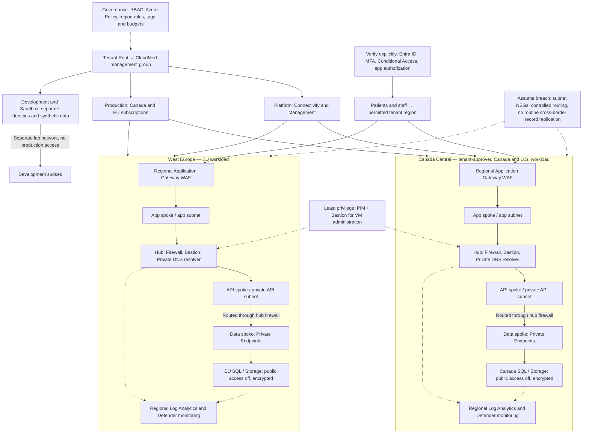

# CloudMed Solutions | Zero Trust Azure landing zone

**CST8913 Cloud Migration · Lab 10 · Chukwudubem Chukwurah**

## 1. Company overview

CloudMed Solutions provides MedConnect to hospitals and clinics in Canada, the United States, and Europe. Patients and clinicians use it for telehealth and medical records, while approved clinical teams use health analytics. The landing zone must support a public patient interface while protecting electronic medical records and the internal services that process them.

The design uses **Canada Central** and **West Europe**. Assign each tenant a data region based on its contracts, legal obligations, and approved data flows. Serve approved U.S. tenants from Canada Central only after a cross-border and contract review. Keep records, backups, and identifiable diagnostic data in their approved region. If a contract requires U.S. residency, hold that onboarding until an approved U.S. region is available. This is a design, with no Azure resources deployed.

| Driver | Design response and evidence |
| --- | --- |
| HIPAA, where applicable | Classify ePHI, restrict access by job, encrypt at rest and in transit, and retain audit evidence. Review the applicable business associate agreement, covered services, and incident processes before production. |
| GDPR | Document lawful processing and retention, use EU processing for EU tenants by default, and review any transfer outside the EEA. Test retrieval and deletion workflows where applicable. |
| PIPEDA, where applicable | Minimize collection, safeguard health information, and document responsibility for service providers and approved cross-border processing. |
| Availability and operations | Design for availability zones where supported. Set and test workload recovery objectives with clinical owners, and test restoration within the approved jurisdiction. |

Controls help satisfy requirements. A compliance owner must validate the full legal, contractual, and operational obligations before launch.

## 2. Governance and identity

```text
Tenant Root
└── CloudMed
    ├── Platform
    │   ├── Connectivity subscriptions (Canada and Europe hubs)
    │   └── Management subscription (governance and security tooling)
    ├── Landing Zones
    │   ├── Production (separate Canada and EU subscriptions)
    │   └── Development (synthetic data only)
    └── Sandbox (isolated, no patient data)
```

Use Microsoft Entra ID groups for workforce access. Require MFA and Conditional Access for staff, with compliant devices for administrative access and location or risk conditions based on approved operations. Use a separate customer identity flow for patients. The MedConnect app verifies tokens and enforces tenant and record-level permissions for every sensitive action. Azure RBAC governs Azure resources and does not replace MedConnect authorization.

| Role | Assigned permissions |
| --- | --- |
| Platform administrators | Eligible, time-limited PIM roles at the required platform subscription or resource group. Require MFA and approval for privileged activation. Audit use and maintain monitored emergency accounts. |
| DevOps | Routine contributor access in development. Production deployments use federated CI/CD identities scoped to individual workload groups with an approved release. Engineers receive read access and time-limited access for incidents. |
| Finance | Cost Management Reader at designated scopes. Resource spending visibility does not grant access to SQL rows, blobs, or secrets. |
| Workloads | Managed identities scoped to the minimum data-plane permissions, such as connecting the API identity to only the required SQL database role. Store remaining secrets in Key Vault. |

Assign Azure Policy at the management group with workload-specific initiatives. Enforce region allowlists, required tags (`Owner`, `Environment`, `CostCenter`, and `DataClassification`), secure transport, and restricted public exposure. Roll out in audit mode before switching relevant rules to deny. Use time-limited, documented exceptions approved by governance. Use policy remediation for eligible settings on existing resources.

## 3. Network architecture

Build one hub per region. Each hub includes Azure Firewall, Bastion for approved VM administration, and Azure DNS Private Resolver linked to approved private DNS zones. Use dedicated hub subnets for these components. The management layer collects telemetry in **regional Log Analytics workspaces**. A workspace is a managed service, so it is shown as a monitoring dependency and does not sit in a hub subnet.

Peer each region’s workload spokes to its hub. Split application, API, and private endpoint traffic into separate subnets with network security groups. The only approved public entry is a regional Application Gateway WAF. Its encrypted backend connection reaches the app tier, which calls the API tier over a restricted private path. Data-tier Azure SQL and Storage sit behind Private Endpoints with public network access disabled. Azure SQL and Storage are managed services and the private endpoint NICs reside in the data spoke. Resolve their private addresses through the regional hub DNS design.

Use route tables for cross-spoke east–west traffic to pass through the regional firewall. Permit only defined application flows and necessary outbound destinations, and validate return routing and DNS. Use NSGs to restrict same-spoke communication. Production and development have no direct peering or shared credentials. Disable public IPs on workload NICs, with a narrowly scoped exception for the gateway and required hub services. Expose no direct administrative ports publicly.

## 4. Zero Trust controls

| Principle | Specific design example |
| --- | --- |
| Verify explicitly | A clinician signs in through Entra ID. Conditional Access checks identity risk, MFA, and device posture. The API checks the token and verifies the clinician can view that tenant’s requested record. |
| Use least privilege | An administrator activates a time-limited PIM role and uses Bastion for an approved VM session. Finance and deployment roles remain separate from patient data access. |
| Use least privilege | The API connects to SQL using a managed identity with narrowly scoped database grants. Other app identities cannot use the same database permissions. |
| Assume breach | Route cross-spoke traffic through the firewall. Restrict subnet paths with NSGs and disable direct public access to SQL and Storage. Require TLS for service calls and encryption at rest. |
| Assume breach | On anomalous login or data access, alert the security team. Revoke sessions or disable the compromised identity, isolate affected workloads, retain regional evidence, and restore from an approved backup when necessary. |

## 5. Monitoring, compliance, and cost

- **Visibility.** Send Entra sign-in logs, Azure Activity Logs, firewall and WAF events, and approved SQL and Storage audit events to the appropriate regional Log Analytics workspace. Use Azure Monitor alerts and Defender for Cloud for security posture and incident investigation. Keep patient payloads out of routine logs. Restrict workspace access, review retention, and run periodic incident-response exercises.
- **Compliance.** Track allowed regions, required tags, encryption configuration, diagnostic settings, and approved exceptions through Azure Policy. Use Defender for Cloud’s regulatory compliance dashboard as a review input. Record an owner, evidence, remediation deadline, and follow-up for each finding. Policy results help demonstrate configuration and do not certify the service.
- **Cost.** Set budgets and alerts per subscription with Finance and engineering recipients. Tag by environment and cost centre and review spend by workload. Right-size capacity, schedule dev shutdowns, and set region-specific log retention. Budget alerts prompt investigation and do not stop resources automatically.

## 6. Conceptual diagram



## 7. Summary and recommendations

This landing zone separates platform administration from workload access and contains incidents within workload and regional boundaries. It gives CloudMed an approved customer edge, private data access, an auditable identity model, and consistent spending controls. Validate media flows and recovery in a preproduction environment with synthetic records before accepting real patient traffic.

1. **Automate the landing zone.** Version Bicep or Terraform modules for management groups, policy, hub networking, and monitoring. Add approval and configuration checks to deployment pipelines and test policy changes in development before production.
2. **Test regional recovery and cost.** Exercise backup restore and identity recovery with clinical stakeholders. Record recovery time, data loss, and monthly spend. Use the results to tune capacity and monitoring costs while respecting approved data boundaries.

## References

- [Microsoft Cloud Adoption Framework: What is an Azure landing zone?](https://learn.microsoft.com/en-us/azure/cloud-adoption-framework/ready/landing-zone/)
- [Microsoft: Zero Trust overview](https://learn.microsoft.com/en-us/security/zero-trust/zero-trust-overview)
- [Azure Architecture Center: Hub-spoke network topology](https://learn.microsoft.com/en-us/azure/architecture/networking/architecture/hub-spoke)
- [Microsoft: Azure Private Endpoint overview](https://learn.microsoft.com/en-us/azure/private-link/private-endpoint-overview)
- [Microsoft: Create and manage Azure budgets](https://learn.microsoft.com/en-us/azure/cost-management-billing/costs/tutorial-acm-create-budgets)
- [U.S. HHS: Summary of the HIPAA Security Rule](https://www.hhs.gov/hipaa/for-professionals/security/laws-regulations/index.html)
- [European Union: GDPR text](https://eur-lex.europa.eu/eli/reg/2016/679/oj/eng)
- [Office of the Privacy Commissioner of Canada: PIPEDA](https://www.priv.gc.ca/en/privacy-topics/privacy-laws-in-canada/the-personal-information-protection-and-electronic-documents-act-pipeda/)
